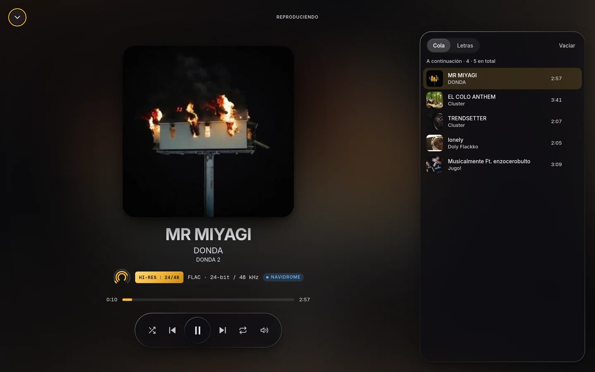
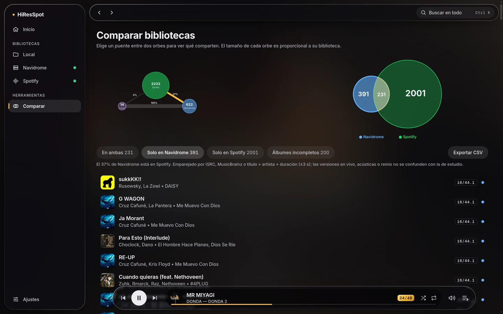

# HiResSpot

[Versión en español](README.md)

Hi-fi music player for desktop (Linux and Windows) and Android featuring native Navidrome support, library comparison, and high-fidelity playback.

[](https://github.com/tonyslabs/hiresspot/actions/workflows/ci.yml)
[](https://github.com/tonyslabs/hiresspot/releases/latest)

Website: [https://hiresspot.drskxll.io](https://hiresspot.drskxll.io)  
Releases and downloads: [https://github.com/tonyslabs/hiresspot/releases/latest](https://github.com/tonyslabs/hiresspot/releases/latest)



---

## Downloads

Files for version 2.0.0:

| Platform | File | Installation / Notes |
|---|---|---|
| Android 7+ | `HiResSpot-2.0.0.apk` | Install allowing unknown sources |
| Linux (Debian / Ubuntu x64) | `hiresspot_2.0.0_amd64.deb` | `sudo apt install ./hiresspot_2.0.0_amd64.deb` |
| Linux (Portable x64) | `HiResSpot-linux-x64-2.0.0.zip` | Extract and run `hiresspot` |
| Windows 10 / 11 x64 | `HiResSpot-Setup.exe` | Squirrel installer (does not require admin privileges) |
| Windows (Portable x64) | `HiResSpot-win32-x64-2.0.0.zip` | Extract and run `hiresspot.exe` |
| Verification | `SHA256SUMS.txt` | SHA-256 checksums for all release binaries |

Binary installation notes:
- On Windows, binaries are not commercially code-signed. Microsoft Defender SmartScreen will show a warning: click "More info" and select "Run anyway".
- On Android, installation from unknown sources must be allowed in device settings to install the APK file.
- macOS is neither supported nor packaged.

---

## Features

- Navidrome client (Subsonic / OpenSubsonic): complete library browsing, favorites, 1–5 star ratings, playlists with covers, track radio, shuffle mix, lyrics (OpenSubsonic) and scrobbling.
- Fidelity indicators: Hi-Res badge (24-bit / 96 kHz, etc.) and visual fidelity ring per track based on sample rate and bit depth.
- Read-only Spotify integration: library synchronization and inspection via OAuth 2.0 PKCE (does not stream or play Spotify audio).
- Visual library comparator: cross-reference tracks across Navidrome, Spotify, and local libraries using orbital views and proportional Venn diagrams. Multi-tier matching engine pairing by ISRC, MusicBrainz lookups, and fuzzy matching by title, artist, and duration (±3-second margin), with CSV export.
- Local library: scan and play local folders containing FLAC and WAV audio files (desktop only).
- Interface and customization: quick command palette (Ctrl+K), light, dark, and system color schemes, and customizable accent colors.
- Desktop audio engine: 10-band equalizer with presets, playback speed without changing pitch, ReplayGain (only attenuates, never boosts), a queue that persists across sessions and keyboard shortcuts.
- Android native player: background and foreground playback service powered by ExoPlayer (AndroidX Media3) providing uninterrupted audio with the screen off, system notification media controls, audio focus handling, native gapless advance to the next track, bottom navigation bar, and secure session management via Android Keystore.
- Non-standard FLAC metadata mitigation: approximately 47% of real-world FLAC files in test libraries contain `PICTURE` blocks with empty MIME type fields that Chromium-based engines reject during playback. On desktop, HiResSpot bypasses this via an internal local stream proxy that strips malformed picture headers while keeping audio data byte-for-byte identical. On Android, ExoPlayer handles and plays them natively without errors.

---

## Library Comparator



---

## Honest Limits

- Not bit-perfect: audio streams pass through the operating system mixer on all supported platforms.
- Spotify is read-only: it does not play Spotify audio. With a Spotify app in development mode its current restrictions apply (limited list of allowed users, Premium owner account).
- Android differences: the mobile application currently omits local folder scanning, Spotify library sync, and the equalizer.
- Unsigned Windows executables: without an expensive commercial code-signing certificate, Windows SmartScreen will show an advisory prompt.
- No macOS support: no builds or continuous integration tests are maintained for macOS.

---

## Security and Privacy

Security policy and how to report a vulnerability: [SECURITY.md](SECURITY.md).

- Desktop (Electron): sandbox enabled, `contextIsolation`, strict CSP, a custom protocol limited to the folders you authorize, and sender verification on every IPC call.
- Protected credentials: sensitive credentials and tokens are encrypted with operating system keyrings (`safeStorage` on desktop, Android Keystore on mobile). When a secure system keyring is unavailable, passwords are not persisted to disk.
- Spotify authentication: OAuth 2.0 with PKCE without embedding or transmitting client secrets.
- No telemetry, trackers or accounts of its own. The app only talks to your Navidrome server and, if you use those features, to Spotify and MusicBrainz.

---

## Development

### Prerequisites

- Node.js >= 22.13.0
- For Android builds: JDK 21 and Android SDK configured in the `ANDROID_HOME` environment variable

### Commands

```bash
# Install monorepo dependencies
npm install

# Start the desktop app in development mode
npm start

# Run TypeScript typechecks across all workspaces
npm run typecheck

# Run automated tests (183 vitest tests across core and ui)
npm test

# Run landing page tests (44 Node test runner tests)
node --test apps/landing/test/

# Package desktop application (.deb and .zip on Linux; installer and .zip on Windows)
npm run make -w @hiresspot/desktop

# Build debug APK for Android
npm run apk -w @hiresspot/android

# Build release APK for Android (requires local signing keystore)
npm run apk:release -w @hiresspot/android

# Launch local landing page development server
node apps/landing/dev-server.mjs
```

### Repository Structure

```
hiresspot/
├── apps/
│   ├── android/       # Capacitor 8 mobile app + native Java plugin (Media3 / ExoPlayer)
│   ├── desktop/       # Electron 45 + Electron Forge 8 + Vite 7 desktop application
│   └── landing/       # Static landing website (hiresspot.drskxll.io) and test suite
├── packages/
│   ├── core/          # Domain model, Navidrome/Spotify clients, player engine, comparator
│   └── ui/            # Shared UI components in React 19 and Tailwind CSS 4
└── .github/workflows/ # Continuous integration (ci.yml) and release (release.yml) workflows
```

---

## Releases

- On every push and pull request, `.github/workflows/ci.yml` runs typechecks and all automated tests.
- When pushing a `vX.Y.Z` tag, `.github/workflows/release.yml` automatically compiles Linux binaries (`.deb` and `.zip`) and Windows binaries (`HiResSpot-Setup.exe` and `.zip`), calculates `SHA256SUMS.txt`, and publishes a draft release on GitHub.
- The Android APK is compiled and signed locally with the author's release keystore (which is never stored on GitHub) and attached to the draft release using `npm run release:android -w @hiresspot/android -- vX.Y.Z` via `apps/android/scripts/publish-apk.sh`.

---

## Companion Project

HiResSpot has a sibling project, **Drstify**:
- Web: [https://drstify.drskxll.io](https://drstify.drskxll.io)
- Repository: [https://github.com/tonyslabs/ytconvert](https://github.com/tonyslabs/ytconvert)

Drstify grabs the audio from YouTube; HiResSpot plays it.

Author: [tonyslabs](https://github.com/tonyslabs)

---

## License

[MIT](LICENSE) © 2026 tonyslabs. You may use, copy, modify and distribute the code, keeping the copyright notice and the license.
