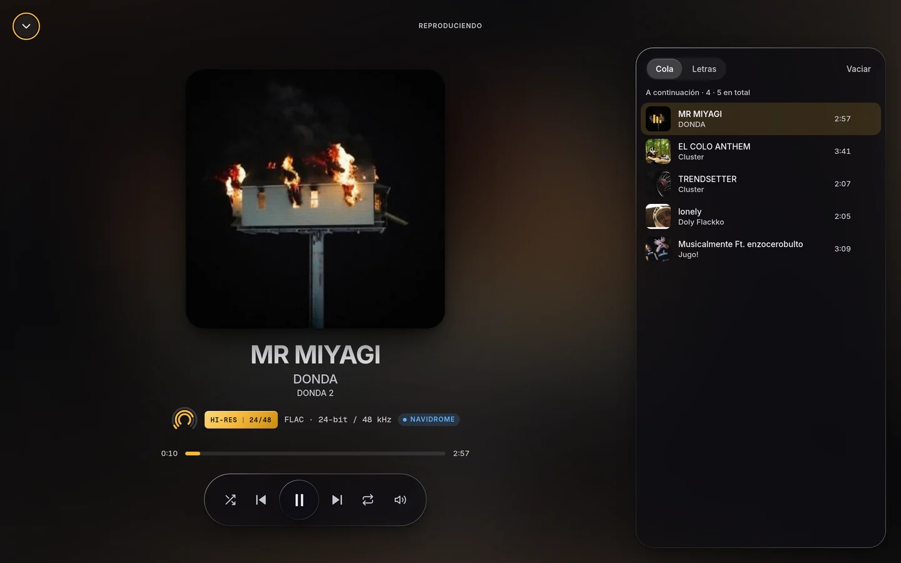
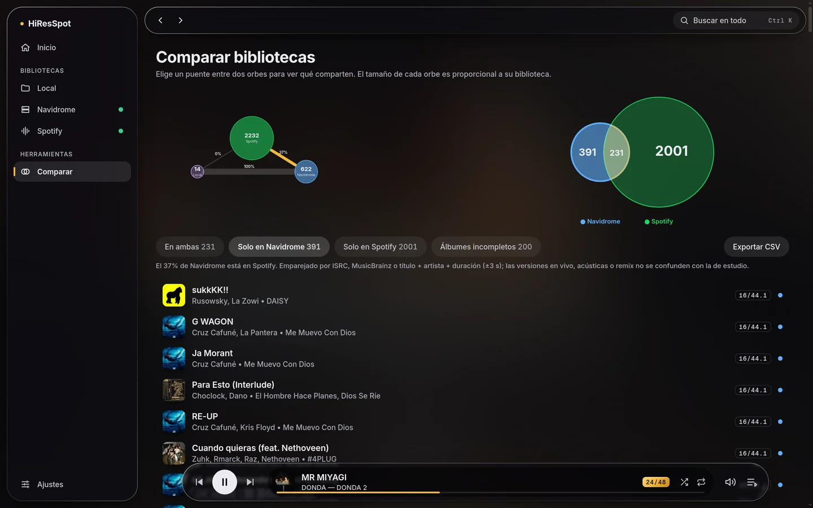

# HiResSpot

[English version](README.en.md)

Reproductor hi-fi para escritorio (Linux y Windows) y Android con soporte nativo para Navidrome, comparación de bibliotecas y reproducción de alta fidelidad.

[](https://github.com/tonyslabs/hiresspot/actions/workflows/ci.yml)
[](https://github.com/tonyslabs/hiresspot/releases/latest)

Sitio web: [https://hiresspot.drskxll.io](https://hiresspot.drskxll.io)  
Releases y binarios: [https://github.com/tonyslabs/hiresspot/releases/latest](https://github.com/tonyslabs/hiresspot/releases/latest)



---

## Descargas

Archivos de la versión 2.0.0:

| Plataforma | Archivo | Instalación / Notas |
|---|---|---|
| Android 7+ | `HiResSpot-2.0.0.apk` | Instalar permitiendo orígenes desconocidos |
| Linux (Debian / Ubuntu x64) | `hiresspot_2.0.0_amd64.deb` | `sudo apt install ./hiresspot_2.0.0_amd64.deb` |
| Linux (Portable x64) | `HiResSpot-linux-x64-2.0.0.zip` | Descomprimir y ejecutar `hiresspot` |
| Windows 10 / 11 x64 | `HiResSpot-Setup.exe` | Instalador Squirrel (no requiere administrador) |
| Windows (Portable x64) | `HiResSpot-win32-x64-2.0.0.zip` | Descomprimir y ejecutar `hiresspot.exe` |
| Verificación | `SHA256SUMS.txt` | Sumas de verificación SHA-256 de todos los archivos |

Notas sobre los binarios:
- En Windows los ejecutables no están firmados comercialmente. Microsoft Defender SmartScreen mostrará una advertencia al instalador: pulsar en "Más información" y después en "Ejecutar de todas formas".
- En Android se debe autorizar la instalación desde orígenes desconocidos para instalar el archivo APK.
- No existe versión ni soporte para macOS.

---

## Qué hace

- Cliente Navidrome (Subsonic / OpenSubsonic): navegación de biblioteca completa, favoritos, valoraciones de 1 a 5 estrellas, playlists con portadas, radio por pista, mezcla aleatoria, letras (OpenSubsonic) y scrobble.
- Indicadores de fidelidad: sello Hi-Res (24-bit / 96 kHz, etc.) y anillo visual de fidelidad por pista según su tasa y profundidad de muestreo.
- Integración de Spotify en solo lectura: sincronización y consulta de biblioteca mediante OAuth 2.0 PKCE (no reproduce audio de Spotify).
- Comparador visual de bibliotecas: cruce entre Navidrome, Spotify y biblioteca local con vista en órbitas y diagramas de Venn proporcionales. Emparejamiento jerárquico por código ISRC, consulta en MusicBrainz y aproximación por título, artista y duración (margen de ±3 segundos), con exportación de resultados a CSV.
- Biblioteca local: escaneo y reproducción de carpetas locales con archivos FLAC y WAV (disponible en la versión de escritorio).
- Interfaz y personalización: paleta de comandos rápida (Ctrl+K), temas claro, oscuro y de sistema, y acentos de color personalizables.
- Motor de audio en escritorio: ecualizador de 10 bandas con preajustes, velocidad de reproducción sin cambiar el tono, ReplayGain (solo atenúa, nunca amplifica), cola persistente entre sesiones y atajos de teclado.
- Motor nativo en Android: servicio de reproducción en primer plano respaldado por ExoPlayer (AndroidX Media3), manteniendo la reproducción continua con la pantalla apagada, controles integrados en el área de notificaciones del sistema, gestión de foco de audio (`audio focus`), cambio nativo sin pausas a la siguiente pista, barra inferior de navegación y almacenamiento seguro de sesiones mediante Android Keystore.
- Manejo de metadatos problemáticos en FLAC: aproximadamente el 47 % de las pistas FLAC reales contienen bloques `PICTURE` con campo MIME vacío que los motores Chromium rechazan al decodificar. En escritorio se soluciona mediante un proxy local transparente que sanea las cabeceras conservando el audio idéntico byte a byte. En Android, ExoPlayer las procesa y reproduce directamente sin errores.

---

## Comparador de bibliotecas



---

## Límites honestos

- No es bit-perfect: la salida de audio atraviesa el mezclador del sistema operativo en todas las plataformas.
- Spotify es solo de consulta: la aplicación no reproduce secuencias de audio protegidas de Spotify. Con una app de Spotify en modo desarrollo aplican sus restricciones vigentes (lista de usuarios autorizados limitada y cuenta propietaria Premium).
- Diferencias en Android: la versión móvil actual no incluye escaneo de carpetas locales, sincronización de biblioteca de Spotify ni ecualizador.
- Binarios de Windows sin firma: no se cuenta con un certificado de firma de código comercial, por lo que Windows SmartScreen emite aviso preventivo.
- Sin soporte para macOS: no se compilan paquetes ni se realizan pruebas sobre entornos macOS.

---

## Seguridad y privacidad

- Escritorio (Electron): sandbox activado, `contextIsolation`, CSP estricta, protocolo propio restringido a las carpetas que autorizas y verificación del remitente en cada llamada IPC.
- Protección de credenciales: almacenamiento cifrado mediante las API de llavero del sistema operativo (`safeStorage` en escritorio y Android Keystore en la aplicación móvil). Si el sistema no dispone de un llavero seguro activo, las contraseñas no se almacenan en disco.
- Conexión con Spotify: flujo OAuth 2.0 PKCE sin necesidad de exponer secretos de cliente.
- Sin telemetría, rastreadores ni cuentas propias. La app solo habla con tu servidor Navidrome y, si usas esas funciones, con Spotify y MusicBrainz.

---

## Desarrollo

### Requisitos

- Node.js >= 22.13.0
- Para compilar Android: JDK 21 y Android SDK configurado en la variable de entorno `ANDROID_HOME`

### Comandos de trabajo

```bash
# Instalar todas las dependencias del monorepo
npm install

# Iniciar la aplicación de escritorio en modo desarrollo
npm start

# Comprobación de tipos TypeScript en todos los paquetes
npm run typecheck

# Ejecutar las pruebas automáticas (183 pruebas en core y ui con Vitest)
npm test

# Ejecutar las pruebas de la landing page (44 pruebas con Node test runner)
node --test apps/landing/test/

# Empaquetar la aplicación de escritorio (.deb y .zip en Linux; instalador y .zip en Windows)
npm run make -w @hiresspot/desktop

# Compilar APK de depuración para Android
npm run apk -w @hiresspot/android

# Compilar APK de release para Android (requiere keystore local)
npm run apk:release -w @hiresspot/android

# Iniciar el servidor local de desarrollo de la landing page
node apps/landing/dev-server.mjs
```

### Estructura del repositorio

```
hiresspot/
├── apps/
│   ├── android/       # Cliente móvil Capacitor 8 + plugin Java nativo (Media3 / ExoPlayer)
│   ├── desktop/       # Aplicación de escritorio Electron 45 + Electron Forge 8 + Vite 7
│   └── landing/       # Sitio estático promocional (hiresspot.drskxll.io) y suite de pruebas
├── packages/
│   ├── core/          # Modelo de dominio, clientes Navidrome/Spotify, motor de audio y comparador
│   └── ui/            # Interfaz de usuario compartida en React 19 y Tailwind CSS 4
└── .github/workflows/ # Flujos de integración continua (ci.yml) y publicación (release.yml)
```

---

## Publicación de versiones

- En cada push o pull request, el flujo `.github/workflows/ci.yml` ejecuta la comprobación de tipos y la totalidad de las pruebas.
- Al publicar una etiqueta con formato `vX.Y.Z`, el flujo `.github/workflows/release.yml` compila de manera automatizada los binarios de Linux (`.deb` y `.zip`) y Windows (`HiResSpot-Setup.exe` y `.zip`), genera el archivo de sumas de control `SHA256SUMS.txt` y crea un release en estado de borrador en GitHub.
- El paquete APK de Android se compila y firma de forma local con la clave privada del autor (la cual no reside en GitHub) y se adjunta al borrador del release ejecutando `npm run release:android -w @hiresspot/android -- vX.Y.Z` a través del script `apps/android/scripts/publish-apk.sh`.

---

## Proyecto hermano

HiResSpot tiene un proyecto hermano, **Drstify**:
- Web: [https://drstify.drskxll.io](https://drstify.drskxll.io)
- Repositorio: [https://github.com/tonyslabs/ytconvert](https://github.com/tonyslabs/ytconvert)

Drstify baja el audio de YouTube; HiResSpot lo reproduce.

Autor: [tonyslabs](https://github.com/tonyslabs)

---

## Licencia

[MIT](LICENSE) © 2026 tonyslabs. Puedes usar, copiar, modificar y distribuir el código, conservando el aviso de copyright y la licencia.
